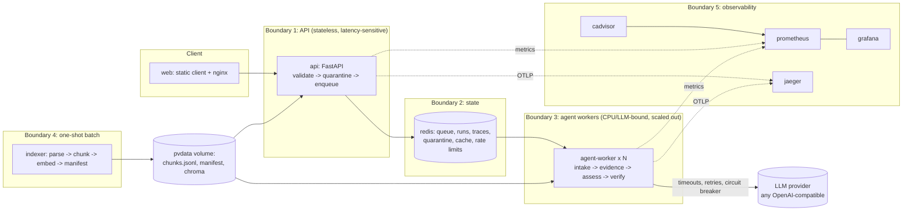

# Architecture

## Topology and deployment boundaries



### Why the boundaries are where they are (D3)

| Boundary | Justification |
|---|---|
| **api / worker split** | *Scaling and resource profile.* The API does milliseconds of work and must stay responsive; a run takes seconds to tens of seconds of mostly waiting on a model. Merging them would let slow runs starve request handling. `--scale agent-worker=N` changes throughput without touching the API. |
| **redis between them** | *Failure isolation.* The queue decouples submission from execution: if workers die the API still accepts and queues; when they return the backlog drains. At-least-once delivery with a lease means a crashed worker's job is requeued, not lost. |
| **indexer as a one-shot** | *Independent lifecycle.* Index building is idempotent and runs rarely; workers must not each rebuild it. `depends_on: service_completed_successfully` guarantees the index exists before anything serves. |
| **web separate from api** | *Independent release.* A UI change must not restart the API. |
| **observability stack** | *Failure isolation.* Monitoring can be down without affecting runs; every app dependency on it is optional (metrics become no-ops, OTel is off if no endpoint). |

## The agent system (A1, A2)

Four agents with distinct responsibilities, communicating only through a shared `RunContext`:

| Agent | Responsibility | Uses model? |
|---|---|---|
| **Intake** | Entity extraction (drug, reaction, demographics, onset latency, outcome), cross-checks the narrative against the structured flags, and escalates early (drug outside corpus, timing unclear, narrative/flag conflict). | No |
| **Evidence** | Owns *tool use*. Loops: what is still missing? -> choose a tool -> observe. Bounded by steps, tool calls and wall-clock. | Yes: translates lay terms, proposes next tool |
| **Assessor** | Turns evidence into a determination (seriousness, expectedness, route, deadline). Every claim gets a verbatim quote. | No (deterministic) |
| **Verifier** | Independent gate. Re-checks every citation against text actually retrieved in this run. Cannot be talked round by the other agents. | No |

```
intake --blocking issue--------------------------------------------> finalize
  |
  v
evidence -> assess -> verify --passed or unrecoverable--> finalize
   ^                     |
   |                     +--failed & retryable--> retry (new strategy)
   +---------------------------------------------------------+
```

**Tools** (the agent chooses; retrieval is not a fixed stage): `search_corpus`, `get_clause`, `get_report_field`, `find_modifiers`, `search_label`.

**How the brief's five steps map to the code**

1. *Retrieve the provision that appears to apply* -> `get_clause("2.7.1")` (IPC timeline).
2. *Does another provision modify it?* -> `find_modifiers(passage)` returns cues/cross-references and a follow-up query.
3. *Search again with a query derived from what it read* -> `search_corpus(derived_query, source=cdsco_rules)`; the derived query is built from the distinctive terms of the passage just read plus the second assessment dimension (expected/unexpected).
4. *Verify the passages support the answer* -> `verify.py`.
5. *Retry with a different strategy, or escalate* -> `route_after_verify` -> `node_retry` (strategy +1) or `finalize` as an escalation.

**Loop bounds** (env-configurable): `AGENT_MAX_STEPS=12`, `AGENT_MAX_TOOL_CALLS=14`, `AGENT_RUN_TIMEOUT_S=45`, `TOOL_TIMEOUT_S=5`, `VERIFY_MAX_STRATEGIES=2`. Exceeding any budget ends the run as an *escalation*, never a guess.

### What happens if an agent fails mid-run
Every node runs inside `_timed()`, which catches exceptions, records `agent_error` in the trace, and routes straight to `finalize`, which produces `human_escalation` with reason `agent_failed:<name>`. A crashed agent can therefore only ever make the system *less* confident. If the whole worker process dies, the lease on the job expires and another worker re-runs it (max 3 attempts, then `failed`). If the LangGraph engine itself throws, the run is retried on the sequential executor that uses the identical node and edge tables.

### Why the model is not asked to decide
Seriousness, expectedness and route come from the decision table in `rules.py`, applied to quotes the verifier re-checks. The model is used for what it is good at (translating "skin peeling" into "exfoliative dermatitis", choosing the next search) and nothing a regulator would hold us to. If the model is down, the rule plan reaches the same answers.

## Resilience (A5)

| Mechanism | Where | Demonstrate with |
|---|---|---|
| Timeout on every LLM call | `ResilientLLM.call` (`LLM_TIMEOUT_S`, capped by remaining run budget) | stub `slow` mode |
| Timeout on every tool call | `call_tool` (`TOOL_TIMEOUT_S`) | unit test / trace `error: timeout` |
| Bounded retry, exponential backoff + jitter | `ResilientLLM.call` (`LLM_MAX_RETRIES`) | `tests/test_resilience.py` |
| Circuit breaker (closed -> open -> half-open) | `CircuitBreaker` | `python scripts/demo.py breaker` |
| Graceful degradation | Evidence agent falls back to `RulePolicy`; summary falls back to a template; run flagged `degraded`, `requires_qppv_confirmation=true` | same |
| Incomplete run never confident | `finalize`: any unmet budget/verification -> `human_escalation` | `tests/test_agent.py::Budgets` |

## Retrieval (L1)

* **Parse:** `pdftotext` (poppler); `pypdf` fallback. We measured pypdf inserting stray spaces inside words on the Gazette PDF ("mus t") and returning ~4x more characters per page (noise), which breaks both exact-quote verification and TF-IDF.
* **Chunk:** per page, 1,200-char window, 800-char stride (400 overlap, longer than the longest sentence we cite). Metadata: source, page, nearest clause number. Page-aware so every citation can name a page.
* **Embed:** optional, using the embedding model configured by `EMBEDDING_MODEL` in `.env`, through LangChain's `Embeddings` into Chroma. Keyed by `(chunk_hash, model)`: changing the model or a chunk re-embeds only what changed (`VectorBackend.sync`), without rebuilding the index.
* **Search:** TF-IDF (exact provision wording, clause ids) fused with vector similarity by reciprocal-rank fusion when vectors are enabled. A `LangChain` `BaseRetriever` adapter (`PVRetriever`) exposes the same index.
* **The section 3 difficulty** (lay vs medical vocabulary) is attacked three ways: curated lay->medical glossary (works with no model), an LLM translation with a versioned prompt, and a follow-up query derived from the label text actually read. We do *not* claim embeddings alone solve it.

## Data flow of one run
`POST /reports` -> validate (schema, range, category, cross-field, injection, toxicity) -> **reject = quarantine, no run** -> `LPUSH` queue -> worker `BLMOVE` claim + lease -> graph -> result + trace -> `GET /runs/{id}`.
